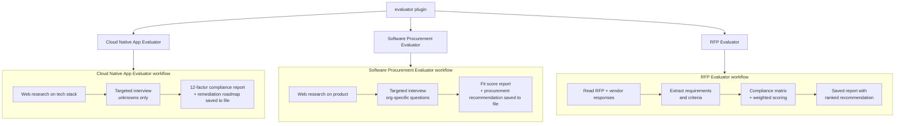

# Evaluator `v2.0.0`

> A collection of agents for evaluating cloud-native application readiness, software procurement decisions, and vendor responses to RFPs.

## Prerequisites

- [VS Code](https://code.visualstudio.com/) with the [GitHub Copilot Chat](https://marketplace.visualstudio.com/items?itemName=GitHub.copilot-chat) extension installed and active.
- Internet access is required for the Cloud Native App Evaluator and Software Procurement Evaluator — both use web research to gather context before asking questions.

## Installation

Install via the VS Code Chat Plugin Marketplace using the `dimpletz/prompts-collection` marketplace source and enable the **evaluator** plugin.

> **Upgrading from v1.x:** this plugin was previously named **software-evaluator**. Uninstall it and install **evaluator** instead.

## Usage

Open Copilot Chat, select the desired agent, and provide the application, product, or RFP documents you want evaluated.

| Agent | Invoke when… |
|-------|--------------|
| **Cloud Native App Evaluator** | You want to assess an application's 12-factor compliance and cloud-native readiness. |
| **Software Procurement Evaluator** | You want to evaluate an off-the-shelf software product for fit against your organization's needs. |
| **RFP Evaluator** | You want to score vendor responses against an RFP's requirements and evaluation criteria and get a ranked recommendation. |

## Hooks

| Event | Script | Description |
|-------|--------|-------------|
| `SessionStart` | [inject-evaluator-dir.ps1](scripts/inject-evaluator-dir.ps1) / [inject-evaluator-dir.sh](scripts/inject-evaluator-dir.sh) | Reads the `EVALUATOR_DIR` environment variable and injects it into the agent context. If not set, all three evaluator agents fall back to `<workspace root>/evaluations/`. |

## Configuration

| Variable | Required | Description |
|----------|----------|-------------|
| `EVALUATOR_DIR` | Optional | Absolute path to the directory where evaluation reports from all three agents are saved. Supports any depth of nested subdirectories. If not set, reports are saved to `<workspace root>/evaluations/`. |

## Components

### Cloud Native App Evaluator

A research-first 12-factor compliance evaluator. Rather than presenting a generic checklist, it:

1. Uses web research to learn the user's tech stack, framework defaults, and deployment platform.
2. Determines which 12-factor concerns are already handled by the platform or framework.
3. Interviews the user only about application-specific unknowns.
4. Produces a context-specific compliance report with scores and an actionable remediation roadmap, saved to `EVALUATOR_DIR` or `<workspace root>/evaluations/`.

**Scope:** 12-factor App methodology evaluation only. Does not perform general code reviews or security audits.

### Software Procurement Evaluator

A research-first procurement fit evaluator based on ISO/IEC 25010. It:

1. Researches the off-the-shelf product (features, integrations, security certifications, pricing, vendor reputation) from public sources.
2. Asks the user only about organizational context (existing systems, workflows, scale, compliance requirements, budget).
3. Scores fit across 10 dimensions and produces a prioritized procurement recommendation report, saved to `EVALUATOR_DIR` or `<workspace root>/evaluations/`.

**Scope:** Off-the-shelf software evaluation only. Does not review custom-built source code or make final purchasing decisions.

### RFP Evaluator

A buyer-side RFP evaluation specialist. Given an RFP and one or more vendor responses (attached files, pasted text, or URLs), it:

1. Extracts every requirement (Mandatory vs Desirable) and the RFP's evaluation criteria, weights, and price formula. If the RFP defines no weights, it proposes defaults and asks you to confirm them.
2. Applies a mandatory pass/fail gate and builds a per-vendor requirements compliance matrix with evidence citations.
3. Scores each vendor on a 0–5 scale per criterion, computes a weighted total out of 100, and compares normalized pricing and TCO.
4. Assesses vendor risks, drafts clarification questions, ranks the vendors, and checks how sensitive the ranking is to the weights.
5. Saves the full report to `EVALUATOR_DIR` or `<workspace root>/evaluations/` and replies with only the saved path.

**Scope:** Evaluating vendor responses to an existing RFP only. Does not write RFPs or bids, negotiate with vendors, or make the final award decision.

## Author

[Dimpletz](https://github.com/dimpletz)
